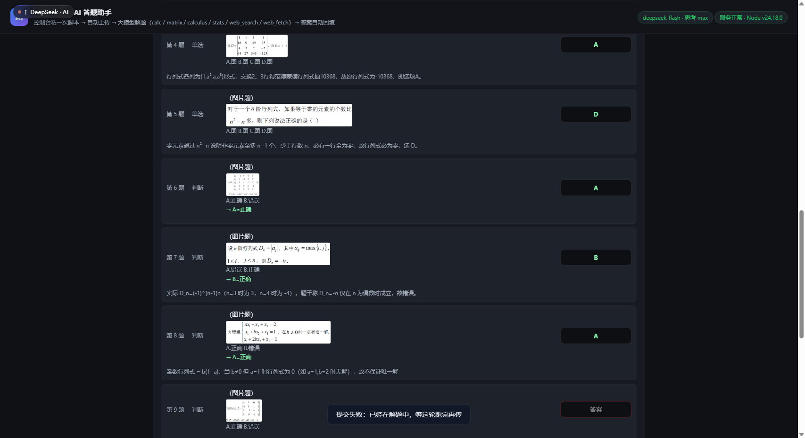

<div align="center">

# course-ai-helper

**在线课程 AI 答题助手** · 一条命令：连上浏览器 → 自动读题 → 多模态大模型解题 → 答案填回页面（或生成答案单）

[](LICENSE)
[](https://nodejs.org/)
[](#零依赖)
[](#可信度拿-scipy--sympy-对过账)
[](CONTRIBUTING.md)
[](#平台支持)
[](#快速开始)

采集题目 → 上传本机助手 → 多模态大模型（带**自研数学引擎**）解题 → **答案自动填回页面**

**本工具只填不交卷** —— 代码里根本没有提交动作，最后一步永远由你点。



</div>

---

## 它解决什么问题

MOOC / 超星的题目**越来越多是图片**（公式、矩阵、几何图），纯文本模型看不了；
而通用 ChatGPT 网页版又没法把答案填回你的答题页。

这个项目的做法 —— **终端一条命令，全程不用复制粘贴题目**：

1. 命令行给它**平台 + 网页链接**；
2. 它用 CDP 连上你**已经登录**的浏览器，把页面脚本注入进去（或直接读 DOM）；
3. 模型解题：内置 6 个工具（矩阵 / 微积分 / 概率统计 / 表达式 / 联网搜索 / 抓网页），涉及计算必须调工具复核；
4. 答案**填回页面**（MOOC / 超星），或写成**答案单 Markdown**（智慧树这类有反作弊检测的平台）；
5. **交卷永远由你自己点** —— 代码里没有任何提交动作。

---

## 亮点

- 🧮 **自研零依赖数学引擎**：矩阵与线性代数、微积分、概率统计三大块，**106 项与 numpy / scipy / sympy 交叉验证全绿**
- 🖼️ **原生多模态**：题目是图片也能做（图片自动下载转 base64 喂给模型）
- 🔒 **没有 `eval` / `new Function`**：表达式走自研解析器 + AST 求值 + 标识符白名单
- 🚫 **永不自动交卷**：只填答案，提交按钮由你自己点
- ⚙️ **纯 TOML 配置**：改完直接重跑，不用重启任何服务
- 🔁 **稳**：模型限流自动退避重试；MOOC 平台"并发限制"自动限速+退避+复核补勾
- 📦 **零依赖分发**：`runtime/node.exe` 便携运行时，对方解压双击 `启动.bat` 就能用，什么都不用装

---

## 固定流程（就这五步）

```
1. 它起浏览器    双击 启动.bat → 选 1/2/3 → 链接直接回车
2. 你登录        第一次在弹出的窗口里登录（之后一直记住）
3. 你找页面      点进作业/测验，看到题目和选项
4. 你按回车      它自动识别答题页，报「已就绪：N 道题」，你核对后回车
5. 它做题        · 中国大学MOOC / 超星  → 答案自动填回页面（不提交）
                 · 智慧树这类只读平台   → 答案直接打在终端里 + 存答案单文件
```

- 等待阶段**不设时间上限**，你慢慢登录、慢慢找页面；它只在 20 秒打一次进度
- 等待时按 Enter：还没识别到页面 = 立即重测；识别到了 = **开始读题+解题**
- 按 Ctrl+C 随时干净退出

终端的答案单长这样（智慧树这类平台的主要交付物）：

```
  ━━ 答案单（照着填）

  1. 【多选】沙盘推演实践教学有哪几个环节组成？（ ）。
       ✅ A. 师生点评环节
       ✅ B. 擂台竞技环节
       ✅ C. 沙盘展示环节
       ✅ D. 战役还原环节
       → 选 A B C D

  2. 【判断】沙盘推演实践教学有助于提升学生的战略思维、战术素养。（ ）
       ✅ A. 对
          B. 错
       → 选 A

  速查：1.ABCD   2.A
```

## 快速开始

```bash
git clone https://github.com/weiza0v0/course-ai-helper
cd course-ai-helper
cp config.example.toml config.toml      # 填上你的 api_key

node cli.mjs mooc "https://www.icourse163.org/spoc/learn/XJTU-1486472169?tid=...#/learn/quiz?id=..."
# 链接也可以不给：
node cli.mjs mooc
```

**链接是可选的**：

- 给了链接 → 它打开/复用那个页面；
- **不给链接（推荐）→ 它把浏览器开好，你自己点进答题页，它自动认出那个页面**。
  所以不需要"先开 Chrome 抄下链接再关掉"这种事。

```
$ node cli.mjs chaoxing "https://mooc1.chaoxing.com/mooc-ans/mooc2/work/task?..."

  在线课程 AI 答题助手 · 终端版   （只填不交卷）
  ──────────────────────────────────────────────────────────────────
  ✓ 浏览器就绪（端口 9222，已连接）
  ✓ 平台：超星学习通（页面脚本模式）
  → 注入页面脚本，让它自己读题…
  → 读到 10 道题，开始解题（deepseek-flash · 思考 max）
  [1/10] 单选  ______把习近平总书记…写入党章。
          🔧 calc({"expression": "..."})
  [1/10] ✅ D  党的十七大
  ...
  ✓ 10/10 已解题 · 耗时 28.0s · 工具调用 26 次
  → 把答案交回页面脚本，让它自己填…
  ⚠ 答案已填入页面。请自己核对后再提交 —— 本工具不会替你提交。
```

**浏览器没开？它会自己拉起来**（带调试端口）。

### 关于登录：**登录一次，之后一直有效**

| | |
| --- | --- |
| 用什么 profile | 助手专用目录 `~/.course-ai-helper-profile`（Windows：`%USERPROFILE%\.course-ai-helper-profile`）|
| 要登录几次 | **一次**。这个目录是持久的，登录态会一直留在里面 |
| 能不能借你日常 Chrome 的登录态 | **不能** —— 见下 |

#### ⚠ 为什么不能借用你日常 Chrome 的登录态

[Chrome 136 起](https://developer.chrome.com/blog/remote-debugging-port)，Google 做了一项安全加固：

> 如果尝试调试**默认的 Chrome 数据目录**，`--remote-debugging-port` / `--remote-debugging-pipe` **将不再被遵循**。
> 这些开关必须与 `--user-data-dir` 搭配、指向**非标准目录**。

也就是说：拿你日常的 profile 开调试端口，Chrome 会**直接忽略**这个参数 —— 工具连不上去。
这从设计上就堵死了"借用你日常登录态"这条路（它本来就是为了防恶意工具偷 cookie 才加的）。

所以本工具**固定用一个非默认目录**（助手专用 profile）。想换目录可以用
`[cdp] profile`，但**必须是非默认目录**。

> 第一次跑会打开一个"干净"的浏览器 —— 在那个窗口里登录一次就行，之后不用再登。
> 想换账号：删掉那个 profile 目录，或者 `[cdp] profile` 指到另一个非默认目录。

> 💡 进阶：Chromium 官方的 **Chrome for Testing** 不受这条限制，仍可对默认目录开调试端口。
> 本工具没有内置它，但你可以把 `[cdp] browser` 指到它。

### 浏览器是怎么找的

**不扫描磁盘**，只对各系统的标准位置做存在性检查（`fs.existsSync`）：

| 系统 | 查这些位置 |
| --- | --- |
| Windows | `%ProgramFiles%\Google\Chrome\Application\chrome.exe`、`Program Files (x86)`、`%LOCALAPPDATA%`、`Microsoft\Edge` |
| macOS | `/Applications/Google Chrome.app/...`、`Microsoft Edge.app` |
| Linux | `PATH` 里的 `google-chrome` / `chromium` / `microsoft-edge`（用 `which` 确认真能跑）|

找不到时（便携版、小众浏览器、非常规安装）会**问你一次**，答案记进 `config.toml` 的 `[cdp] browser`。

### ⚠ `browser` 和 `profile` 是两件事

| 配置 | 管什么 |
| --- | --- |
| `[cdp] browser` | **用哪个程序**打开（可执行文件路径）|
| `[cdp] profile` | **用哪套登录态**（传给 Chrome 的 `--user-data-dir`）|

**填了 browser 并不等于确定了 profile** —— 比如便携版 Chrome 放在 `D:\Chrome\chrome.exe`，
它的登录态一般在 **exe 同级或上级的 `User Data`**，不在系统标准目录里。

> ⚠ 另外：`[cdp] profile` **不能指向默认数据目录**（Chrome 136+ 会忽略调试端口）。

所谓"profile 探测"现在只用于**信息展示**（`--doctor` 里告诉你日常 profile 在哪），
实际用的是助手专用目录。所以你填的 profile 只有一种用途：**换一个非默认目录**。

1. 从 exe 文件名判断"家族"（`chrome.exe` / `msedge.exe` / `360…` / `QQBrowser…`），
   只去该家族对应的目录找；
2. 优先看 **exe 同级 / 上级的 `User Data`、`u-data`、`profile`**（便携版、绿色版常见布局）；
3. 再看该家族的系统标准目录；
4. 都找不到 → **问你一次** User Data 目录，答案记进 `[cdp] profile`；
   直接回车则用助手专用 profile（登录一次会记住）。

> Chrome 传给 `--user-data-dir=<User Data>` 之后会自己打开**上次用的那个 profile**，
> 所以不用我们区分 `Default` / `Profile 1`。

Windows 免安装：先 `node scripts/fetch-node.mjs` 拉一个便携 node，之后双击 `启动.bat`
（会问你平台和链接）。

**常用参数**

| 参数 | 说明 |
| --- | --- |
| `--list` | 列出浏览器里已打开的标签（并标出哪个是已知平台的答题页） |
| `--port 9222` | 浏览器调试端口 |
| `--rounds 8` | **每题最多让模型调几轮工具**（默认取 `config.toml` 的 `max_tool_rounds = 4`）。调大更稳更慢，调小更快但容易算错 |
| `--sheet` / `--no-fill` | 只解题、生成答案单，**完全不动页面** |
| `--new` | 强制开一个新标签 |
| `--doctor` | 诊断：浏览器在不在、用哪个 exe/profile、调试端口通不通（不启动任何东西）|
| `--selftest` | 离线自检（不连浏览器、不调模型，32 项）|

## 六个工具

计算**全部本地完成、零依赖**（`lib/math/*` 是自己写的），不调任何外部计算服务。

### `matrix` — 线性代数

行列式 · 逆 · 秩 · 迹 · 转置 · **RREF（含主元列）** · 加减乘幂 · **解 Ax=b（带残差验证）** ·
**特征值（任意实方阵，支持复根）** · LU / QR 分解 · 零空间基 · 四种范数

### `calculus` — 微积分

**符号求导**（任意阶，多项式/三角/指数/对数/商/链式/幂指函数）· **积分**（给区间→自适应 Simpson 数值定积分；不给→符号原函数）·
**极限**（双侧/单侧，能识别发散到 ±∞）· **求根**（`x^2-5x+6=0` 直接写，返回区间内全部实根 + 代入残差）·
Taylor 展开 · 级数求和 · 化简

### `stats` — 概率统计

描述统计（含偏度峰度）· **六种分布的 pdf/cdf/反函数**（normal / t / χ² / F / binom / poisson / exp）·
单样本/双样本(Welch+合并方差)/配对 t 检验 · z 检验 · 卡方拟合优度与独立性（可选 Yates 校正）·
单因素方差分析 · 一元线性回归 · Pearson/Spearman · 组合排列 · 贝叶斯

### `calc` — 通用表达式

`+ - * / % ^`、`pi`/`e`、隐式乘法（`2x`、`3(x+1)`）、向量 `[1,2,3]`、矩阵 `[[1,2],[3,4]]`，
以及上面所有函数的一站式入口。

### `web_search` / `web_fetch`

Bing 优先、DuckDuckGo 兜底；抓网页正文去标签。用来查证定义、定理、公式、题目出处。

---

## 可信度：拿 scipy / sympy 对过账

自研数学最大的风险是"算得看起来像对"，所以整套数学层都跟 **numpy / scipy / sympy** 逐项比对：

```
$ python3 test/math-ref.py > test/math-ref.json   # 生成参考值
$ node test/math-test.mjs
数学层交叉验证（对照 numpy / scipy / sympy）
  通过 106 项，失败 0 项
  ✅ 全部与 numpy/scipy/sympy 一致
```

覆盖：4 阶行列式、范德蒙德行列式、逆矩阵、秩、四种范数、解方程、**复特征值 ±i**、LU/QR 分解校验、零空间维数；
八类求导、七类定积分（含 ∫₀¹e^(-x²)、∫₋₁¹|x|）、三类极限（含发散）、求根、Taylor、级数；
t/z/卡方/方差分析/回归/相关；六种分布的 pdf/cdf/分位数；Γ/B/erf/erfc、组合排列。

应用层：`node cli.mjs --selftest` —— **23 项全绿**（平台注册表、桥接层、页面脚本注入、答案单渲染、配置、六个工具实算），离线可跑、不连浏览器、不调模型。

真实模型端到端（10 道真题，答案由 100 分交卷确认）：

```
1.单选→D ✅  2.单选→A ✅  3.单选→D ✅  4.单选→A ✅  5.单选→D ✅
6.判断→A ✅  7.判断→A ✅  8.判断→B ✅  9.判断→B ✅  10.判断→A ✅
耗时 28.0s · 工具调用 26 次 · 思考片段 25 段 · 正确 10 / 错误 0
```

> **全程只认选项字母**（单选/多选/判断都是）。判断题尤其要注意：同一份卷子里 Q6 的 A 可能是「正确」，
> Q7 的 A 却是「错误」——**选项顺序逐题都不同**，所以模型被要求"先看清本题 A/B 各写了什么，再回答字母"。

---

## 平台支持

| 平台 | 模式 | 状态 |
| --- | --- | --- |
| **中国大学 MOOC**（icourse163.org） | 页面脚本 → 自动填答 | ✅ 完整可用，已实测真实测验页 10/10 自动勾选、**未提交** |
| **超星学习通**（chaoxing.com） | 页面脚本 → 自动填答 | ✅ 就绪；答题态 DOM 待社区用真实未作答作业校准（见 [docs/chaoxing-adapter.md](docs/chaoxing-adapter.md)） |
| **智慧树**（zhihuishu.com） | **CDP 只读 → 答案单** | ✅ 读卷 + 解题 + 出答案单；🚫 **刻意不做自动填答**（见下） |

### 两种模式

- **页面脚本模式**（MOOC / 超星）：终端用 CDP 把平台自己的页面脚本注入页面 ——
  脚本里有经过实测的"读题 / 勾选 / 限流退避 / 复核补勾"逻辑，**一个字都不用改**，
  只是不再需要你手动往控制台粘贴。脚本的 `fetch` 被终端接管：它把题目交给终端，
  终端解题后再把答案交回去，由脚本自己填。
- **CDP 只读模式**（智慧树）：只从浏览器层读 DOM（`DOM.getDocument{pierce:true}`），
  **不执行页面脚本、不点击任何东西**，答案写成答案单。

### 为什么智慧树只能"只读"

智慧树把题干预设在**闭合 Shadow DOM** 里 —— 页面内的 JS 一律读不到
（`textContent`/`innerHTML`/`Range`/选区/`attachShadow` 钩子/Vue 数据 逐个实测，全是空的）。

而一旦在页面上自动点选项，**脚本点击的 `event.isTrusted === false` 会立刻暴露**。
实测中该账号确实弹出了平台的告警：

> 检测到异常脚本，为保证您正常答题，请您关闭插件，刷新页面后重新答题！

所以这个平台**主动砍掉了自动填答**，只做「只读读卷 → 模型解题 → 生成答案单 → 你自己填」。
细节和踩过的坑都在 [docs/zhihuishu-adapter.md](docs/zhihuishu-adapter.md)。

> ⚠ 智慧树的**选项顺序每次加载都会重排**。答案单里每个字母旁边都印了选项原文，
> 重排后按文字对照填就不会错。

## 仓库结构

```
course-ai-helper/
├─ cli.mjs                 # 终端入口：node cli.mjs <平台> <链接>
├─ lib/                    # 共享核心（只有一份）
│  ├─ agent.mjs            #   模型调用 + 工具循环 + 答案解析
│  ├─ tools.mjs            #   六个工具
│  ├─ math/                #   自研数学引擎（零依赖）
│  ├─ cdp.mjs              #   零依赖 CDP 客户端（Node 22+ 自带 WebSocket）
│  ├─ bridge.mjs           #   把页面脚本变成"终端驱动"的桥接层
│  ├─ report.mjs           #   答案单 Markdown 渲染
│  ├─ platforms.mjs        #   平台注册表
│  └─ config.mjs / toml.mjs
├─ platforms/              # 每个平台只有「标识 + 页面脚本 + 适配」
│  ├─ mooc/index.mjs       + console/{helper,collect,fill}.js
│  ├─ chaoxing/index.mjs   + console/helper.js
│  └─ zhihuishu/index.mjs  （CDP 只读，零点击代码）
├─ test/                   # 数学校验（106 项）+ 真实模型端到端
├─ scripts/                # fetch-node.mjs（拉便携 node）/ package.mjs（打包）
├─ docs/                   # 截图 + 各平台适配笔记
├─ 启动.bat                 # Windows：问平台 + 链接，然后开跑
└─ 启动带调试浏览器.bat       # 想先自己登录时用（带 --remote-debugging-port 的 Chrome）
```

**没有网页、没有服务、没有 npm 依赖**：就是一个 Node 脚本，直连浏览器。

## 配置

`platforms/<平台>/config.toml`（从 `config.example.toml` 拷）：

```toml
[model]
base_url = "https://api.deepseek.com/v1"   # 任何 OpenAI 兼容接口
api_key  = ""                              # 必填；只在本机，不会下发到浏览器
model    = "deepseek-flash"                # 必须支持图片输入
reasoning_effort = "max"                   # 思考强度：off/low/high/max —— 数学题别关
concurrency = 3
max_tool_rounds = 4                        # 工具轮数用完会强制模型收尾作答
max_retries = 3                            # 撞 429/5xx 指数退避重试

[app]
auto_solve = true          # 收到题目就自动开解
auto_fill  = true          # 出答案自动推回页面并勾选
fill_interval_ms = 400     # 两次勾选的间隔（MOOC 每勾一次就发一次保存请求，太快会被平台限流）
```

---

## 安全与边界

- **永不自动交卷**：代码里没有提交动作。
- **无 `eval` / `new Function`**：早期版本用 `new Function` + 字符白名单，被 `process.exit(1)` 逃逸过一次
  （真把测试进程退掉了），现在改成自研解析器 + AST + 标识符白名单。
- **API Key 不出本机**：只存在 `config.toml`，终端只显示掩码。
- 只通过 **CDP 本机调试端口**驱动浏览器（`127.0.0.1`），不对外开任何端口、不联网暴露任何东西。
- 桥接层只拦截页面脚本自己要调的那两个路径，页面脚本的其它网络请求原样放行。
- 本项目是**答题辅助**。多数课程把"独立完成"写进了学术诚信条款；**怎么用、用不用，责任在你**。
- 有监考、人脸识别、摄像头抓拍的考试请勿使用。

---

## 参与贡献

特别欢迎这几类 PR（详见 [CONTRIBUTING.md](CONTRIBUTING.md)）：

- 🥇 **超星答题态 DOM 校准**（跑一次 `diagnose()` 贴 issue 就算贡献）
- 🥈 新平台适配：智慧树 / 雨课堂 / 学堂在线 / 钉钉课堂 …
- 🥉 数学引擎补强：符号积分再强一点、线性规划、常微分方程、复数运算
- 文档、截图、Windows 打包脚本、模型兼容性测试（Qwen-VL / GLM-4V / GPT-4o / Gemini）

## License

[MIT](LICENSE)
